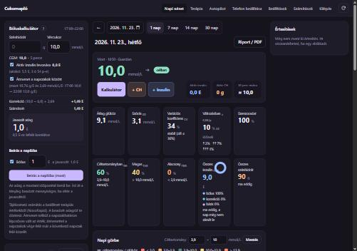
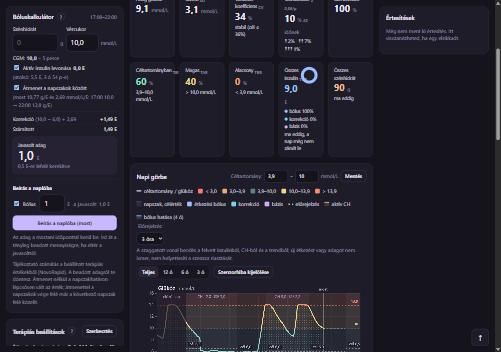
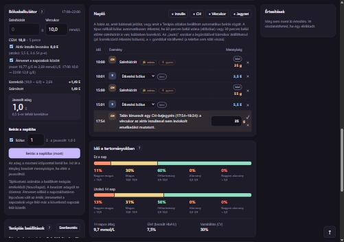
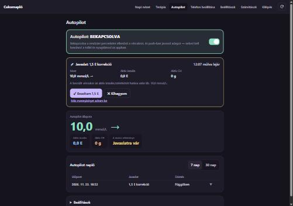
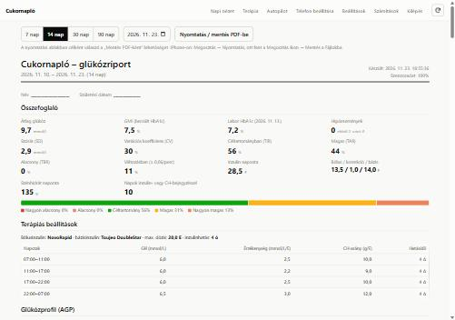

# Cukornapló

Saját webes napló Guardian 4 szenzorhoz: a glükóz a CareLinkből jön, az inzulint (bólus, bázis) és a
szénhidrátot kézzel könyveled (napló, bóluskalkulátor); minden egy helyen, közös időtengelyen. Nuxt 4 (SPA) + Nitro szerver, SQLite (`node:sqlite`).

Nem orvostechnikai eszköz. Kezelési döntéshez a Guardian app értékeit és a diabetológusod útmutatását használd.

> A képernyőképek szintetikus demó-adaton készültek (`scripts/seed-demo.mjs`), nem valódi egészségügyi adaton.

<p>
  
  
  
</p>
<p>
  
  
</p>

## Funkciók

- **Belépés / jelszó** – `/setup` (első jelszó), `/login`, kilépés. Munkamenet lezárt
  sütiben (bcrypt; a korábbi PHP-s változat `$2y$` hash-e is működik). IP-nkénti
  próbálkozás-korlát: a kliens IP a `CLIENT_IP_HEADER` fejlécből, különben az
  X-Forwarded-For utolsó, proxy által írt eleméből jön, így nem hamisítható. Az első
  jelszóhoz távolról 8 jegyű beállító kód kell (`docker logs`).
  Az `/api/**` végpontok munkamenethez kötöttek (kivéve az adatfogadót, ami X-Token).
- **Napi nézet** (`/`): három összehangolt panel közös időtengelyen (glükóz / inzulin /
  szénhidrát) – az időpontok pontosan egymás alá esnek, egyesített tooltippel. A glükóz
  panelen céltartomány-sáv, alatta piros / felette sárga kiemelés, bal oldalt „utolsó
  aktív vércukor”. **Állítható céltartomány** (a fejlécben, a `settings.json`-ba mentve).
  Tile-ok, napló, idő-a-tartományokban, GMI/CV, 14 napos összesítő.
- **Adatok és import** (`/adatok`): tárolt adatok, API-kulcs (+ új kulcs), CareLink
  **összekötő UI** (belépési cím, kód beillesztése, lekérés most, páciensváltás, nyers
  válasz letöltése, bontás), **kézi import**, és a **Visszaállítás** zóna:
  *mért adatok törlése* és *minden elölről (gyári visszaállítás)*.
- **Telefonos beállító varázsló** (`/telefon`, csak InPen / Apple Health használatához): kapcsolatteszt, InPen → Egészség app,
  küldés módja (Health Auto Export / Parancsok), próba élő figyelővel.
- **Adatfogadó API** – `POST /api/ingest` (a régi telefonos beállítások miatt az
  `/api/ingest.php` cím is működik).
- **CareLink** – a Guardian szenzor értékei gondozói fiókkal, háttér-pollerrel
  `CARELINK_INTERVAL` másodpercenként (alapból 300 = 5 perc).
- **Apple Health `export.xml` importáló** (CLI, streamelve):
  `DATA_DIR=... node scripts/import-health-export.ts <export.xml> [kezdő dátum]`.
- **Autopilot** (`/autopilot`, alapból kikapcsolva): percenkénti háttérellenőrzés az aktív inzulin / szénhidrát
  és a trend alapján; mivel tollal (nem pumpával) jár az inzulin, a javasolt korrekció **push-értesítés**, amit
  nyugtázni kell („Beadtam” / „Kihagyom”) – a motor sosem ír a naplóba magától. Napló, saját beállítások
  (napi max, várakozási idő, biztonsági korlátok).
- **Be nem írt CH felismerése**: óránkénti háttérellenőrzés jelzi, ha egy szakaszban a vércukor-emelkedést
  az aktív inzulin nem indokolja (valószínűleg elmaradt egy CH-bejegyzés). A becslés addig nem számít
  a statisztikába, amíg a napi naplóban el nem fogadod (a mennyiséget is módosíthatod) vagy el nem utasítod.

## Fejlesztés

```bash
pnpm install
pnpm dev          # http://localhost:3000
```

### Adatmappa (`DATA_DIR`)

- Napi automatikus mentés: `data/backup/diabetes-ÉÉÉÉ-HH-NN.sqlite` (utolsó 7 nap, éjjel 3 után készül). Visszaállítás: állítsd
  le a szervert, másold a mentést a `data/diabetes.sqlite` helyére, és töröld a `diabetes.sqlite-wal` és `-shm` fájlt.
  A „Minden elölről” a mentéseket nem törli.
- Alapértelmezés: a projekt `./data` mappája (nincs verziókezelve).
- Kísérletezéshez külön mappa adható meg, pl. egy demó-példány:

```bash
mkdir data-dev && node scripts/seed-demo.mjs ./data-dev   # ~10 nap szintetikus adat (NEM valódi)
DATA_DIR=./data-dev CARELINK_INTERVAL=0 pnpm dev
```

Első belépéskor (`/setup`) állíts be jelszót, pl. **`cukor1234`**. A `scripts/seed-demo.mjs` a fenti
képernyőképekhez is ezt generálja.

## Docker (Raspberry Pi)

Image build és feltöltés a repó gyökeréből (csak 64 bites Pi OS / DietPi: a `node:24-alpine`
image-nek nincs 32 bites ARM változata):

```bash
docker buildx build --platform linux/arm64 -t baltazarka/cukornaplo-nuxt:latest --push .
```

Futtatás: a `docker-compose.yml` (vagy ugyanez Portainer-stackként). Környezeti változók:
`DATA_DIR=/data`, `CARELINK_INTERVAL`, `CLIENT_IP_HEADER` (Cloudflare mögött:
`cf-connecting-ip`, és ilyenkor a port kívülről ne legyen közvetlenül elérhető).

> Megjegyzés: az SQLite a Node beépített `node:sqlite` moduljával megy (nincs natív fordítás).
> A Nuxt a `4.5.2`-re van rögzítve: a `4.6.0` Windowson minden oldalt 500-zal dönt
> (nuxt/nuxt#36467), Linuxon/Dockerben nincs ez a hiba.
