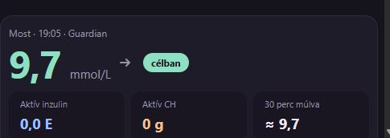
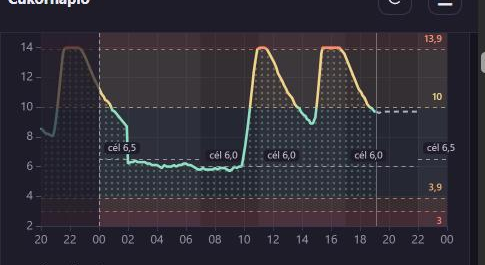
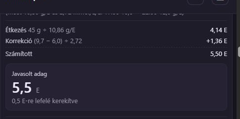
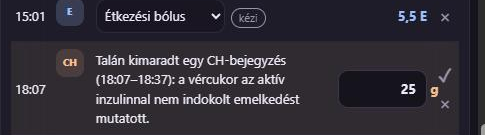
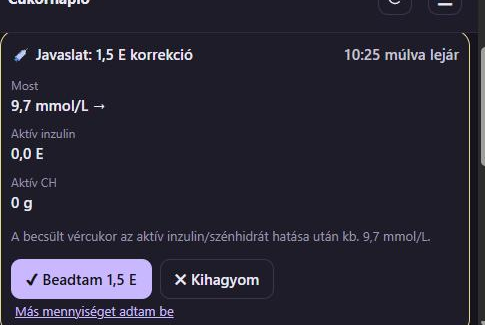
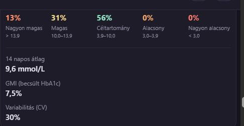
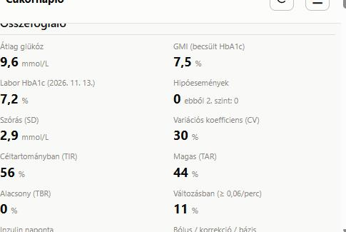
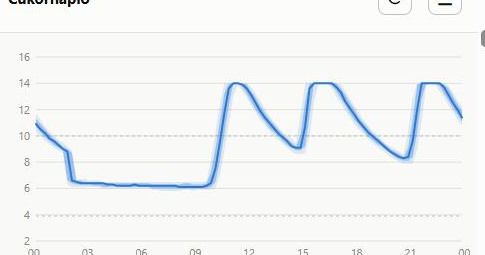
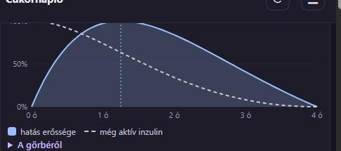
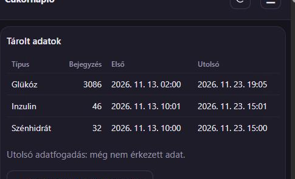

# Cukornapló

Saját, inzulinnal kezelt cukorbetegséghez írt webes napló: a Medtronic Guardian 4 szenzor értékei a gondozói
(CareLink) fiókon át automatikusan bekerülnek, az inzulint (étkezési bólus, korrekció, bázis – tollal,
NovoRapid + Toujeo) és a szénhidrátot a bóluskalkulátoron vagy a naplón át kézzel rögzítem. A cél, hogy a
három adat (glükóz, inzulin, CH) egy helyen, közös időtengelyen, egyetlen nézetben legyen együtt
visszanézhető és elemezhető – ezt sem a Guardian app, sem a gyári exportok nem adták meg.

Azért Nuxt 4 (kliensoldali SPA) + Nitro szerver + SQLite (`node:sqlite`): egyetlen Node-folyamat, nincs
külön adatbázis-szerver, Raspberry Pi-n (Docker) is elfut, mégis modern, reaktív felület. A projekt eredetileg
egy egyszerűbb PHP alkalmazás volt (lásd a git-történetben); ennek Nuxt-alapú újraírása ez a repó – innen
maradt két visszafelé-kompatibilis apróság (a régi `$2y$` jelszó-hash elfogadása, és a telefonon korábban
beállított `/api/ingest.php` cím is működik), de **ma már nincs PHP-kód a projektben** – a teljes alkalmazás
TypeScript/Vue (Nuxt + Nitro).

Nem orvostechnikai eszköz. Kezelési döntéshez a Guardian app értékeit és a diabetológusod útmutatását használd.

> A lenti képernyőképek szintetikus demó-adaton készültek (`scripts/seed-demo.mjs`), nem valódi egészségügyi adaton.

<table>
<tr>
<td align="center" width="50%"><br><sub><b>Napi nézet</b> – „Most” kártya: trend, aktív inzulin, aktív CH</sub></td>
<td align="center" width="50%"><br><sub><b>Napi görbe</b> – glükóz, céltartomány, előrejelzés</sub></td>
</tr>
<tr>
<td align="center"><br><sub><b>Bóluskalkulátor</b> – CH, korrekció, aktív inzulin levonva, napszak-átmenet</sub></td>
<td align="center"><br><sub><b>Napló</b> – felismert, nyugtázásra váró CH-becslés</sub></td>
</tr>
<tr>
<td align="center"><br><sub><b>Autopilot</b> – push-ra váró adagjavaslat, nyugtázással</sub></td>
<td align="center"><br><sub><b>Idő a tartományokban</b> – TIR, GMI, variabilitás (14 nap)</sub></td>
</tr>
<tr>
<td align="center"><br><sub><b>Nyomtatható riport</b> – összefoglaló, laborérték, hipóesemények</sub></td>
<td align="center"><br><sub><b>AGP-profil</b> – napok mediánja, 25–75% / 5–95% sáv</sub></td>
</tr>
<tr>
<td align="center"><br><sub><b>Terápia</b> – napszakos beállítás, inzulinhatás-görbe</sub></td>
<td align="center"><br><sub><b>Adatok</b> – tárolt bejegyzések, CareLink, import, visszaállítás</sub></td>
</tr>
</table>

## Funkciók

- **Belépés / jelszó** – egészségügyi adatról van szó, ezért nem elég egy megjegyezhetetlen link: valódi,
  jelszavas belépés van (`/setup` az első jelszóhoz, `/login`, kilépés), lezárt munkamenet-sütivel (bcrypt;
  a korábbi PHP-s változat `$2y$` hash-e is működik, lásd fent). Mivel otthonról kívülről is elérhető,
  van IP-nkénti próbálkozás-korlát (a kliens IP a `CLIENT_IP_HEADER` fejlécből, különben az
  X-Forwarded-For utolsó, proxy által írt eleméből jön, így nem hamisítható), és az első jelszó
  beállításához távolról egy 8 jegyű, a szerver naplójában megjelenő kód is kell (`docker logs`).
  Az `/api/**` végpontok mind munkamenethez kötöttek (az adatfogadó kivétel, az saját X-Tokent használ,
  mert azt a telefon küldi, nem egy bejelentkezett böngésző).
- **Napi nézet** (`/`) – ez a kezdőlap, amit naponta többször megnézek. A lényeg, hogy a glükóz, az
  inzulin és a szénhidrát egy közös időtengelyen, egymás alatt látszik (egyesített tooltippel) – sem a
  Guardian app, sem egy táblázatos export nem adja meg ezt az együttes képet. A glükóz-panelen
  céltartomány-sáv (alatta piros, felette sárga kiemelés), bal oldalt a legutóbbi mért érték.
  **Állítható céltartomány** (a fejlécben, a `settings.json`-ba mentve). Tile-ok, napló, idő-a-tartományokban,
  GMI/CV, 14 napos összesítő.
- **CareLink** – a Guardian 4 szenzor mérései nem hivatalos API-n (a carepartner felhőn, gondozói
  fiókkal) át, háttérben, `CARELINK_INTERVAL` másodpercenként (alapból 300 = 5 perc) kerülnek be, külön
  teendő nélkül.
- **Adatok és import** (`/adatok`) – a tárolt adatok áttekintése (típusonként hány bejegyzés, mettől
  meddig), az API-kulcs kezelése (+ új kulcs), a CareLink **összekötő UI** (belépési cím, kód beillesztése,
  lekérés most, páciensváltás, nyers válasz letöltése és bontása – hasznos, ha a kapcsolat elromlik),
  **kézi import**, és a **Visszaállítás** zóna: *mért adatok törlése* vagy *minden elölről (gyári visszaállítás)*,
  ha újrakezdeném.
- **Telefonos beállító varázsló** (`/telefon`) – ma már nem aktívan használt, régebbi beállítási mód
  maradványa, amikor az InPen okos tollal és Apple Egészséggel ment az adat a szerverre (kapcsolatteszt,
  InPen → Egészség app, küldés módja Health Auto Export / Parancsok, próba élő figyelővel); a régi
  adat (`source='manual'`) ma is a naplóban van, csak az élő adatgyűjtés már nem ezen megy.
- **Adatfogadó API** – `POST /api/ingest`, ezen jön be (vagy jött be korábban) minden külső forrásból
  (InPen/Apple Health, régi telefonos beállítás) érkező adat; a régi telefonos beállítások miatt az
  `/api/ingest.php` cím is működik.
- **Apple Health `export.xml` importáló** (CLI, streamelve, nagy export-fájlokhoz is):
  `DATA_DIR=... node scripts/import-health-export.ts <export.xml> [kezdő dátum]`.
- **Autopilot** (`/autopilot`, alapból kikapcsolva) – azt a döntési logikát próbálja utánozni, amit egy
  zárt hurkú inzulinpumpa-rendszer (pl. AndroidAPS, Loop) csinálna, de mivel itt tollal (nem pumpával) megy
  az inzulin, egy beadott dózist nem lehet "visszavonni": ezért percenként ellenőriz (aktív inzulin,
  szénhidrát, trend), és a javasolt korrekciót **push-értesítésként** küldi ki, amit nyugtázni kell
  („Beadtam” / „Kihagyom”) – a motor sosem ír a naplóba magától. Saját napló, saját beállítások
  (napi max, várakozási idő, biztonsági korlátok).
- **Be nem írt CH felismerése** – gyakori hiba, hogy eszem valamit, beadom rá az inzulint, de elfelejtem
  beírni a szénhidrátot, ami utólag torzítja a statisztikát (és a CH-arány tanulását). Ezért óránkénti
  háttérellenőrzés jelzi, ha egy szakaszban a vércukor-emelkedést az aktív inzulin önmagában nem indokolja
  (valószínűleg elmaradt egy CH-bejegyzés). A becslés addig nem számít bele semmibe, amíg a napi naplóban
  el nem fogadod (a mennyiséget is módosíthatod) vagy el nem utasítod.

## Fejlesztés

```bash
pnpm install
pnpm dev          # http://localhost:3000
```

### Adatmappa (`DATA_DIR`)

- Napi automatikus mentés: `data/backup/diabetes-ÉÉÉÉ-HH-NN.sqlite` (utolsó 7 nap, éjjel 3 után készül). Visszaállítás: állítsd
  le a szervert, másold a mentést a `data/diabetes.sqlite` helyére, és töröld a `diabetes.sqlite-wal` és `-shm` fájlt.
  A „Minden elölről” a mentéseket nem törli.
- Alapértelmezés: a projekt `./data` mappája (nincs verziókezelve).
- Kísérletezéshez külön mappa adható meg, pl. egy demó-példány:

```bash
mkdir data-dev && node scripts/seed-demo.mjs ./data-dev   # ~10 nap szintetikus adat (NEM valódi)
DATA_DIR=./data-dev CARELINK_INTERVAL=0 pnpm dev
```

Első belépéskor (`/setup`) állíts be jelszót, pl. **`cukor1234`**. A `scripts/seed-demo.mjs` a fenti
képernyőképekhez is ezt generálja.

## Docker (Raspberry Pi)

Kész image: **[`baltazarka/cukornaplo-nuxt`](https://hub.docker.com/r/baltazarka/cukornaplo-nuxt)** (public, `linux/arm64`).

```bash
docker pull baltazarka/cukornaplo-nuxt:latest
```

Saját buildhez (a repó gyökeréből; csak 64 bites Pi OS / DietPi: a `node:24-alpine`
image-nek nincs 32 bites ARM változata):

```bash
docker buildx build --platform linux/arm64 -t baltazarka/cukornaplo-nuxt:latest --push .
```

Futtatás: a `docker-compose.yml` (vagy ugyanez Portainer-stackként). Környezeti változók:
`DATA_DIR=/data`, `CARELINK_INTERVAL`, `CLIENT_IP_HEADER` (Cloudflare mögött:
`cf-connecting-ip`, és ilyenkor a port kívülről ne legyen közvetlenül elérhető).

> Megjegyzés: az SQLite a Node beépített `node:sqlite` moduljával megy (nincs natív fordítás).
> A Nuxt a `4.5.2`-re van rögzítve: a `4.6.0` Windowson minden oldalt 500-zal dönt
> (nuxt/nuxt#36467), Linuxon/Dockerben nincs ez a hiba.
